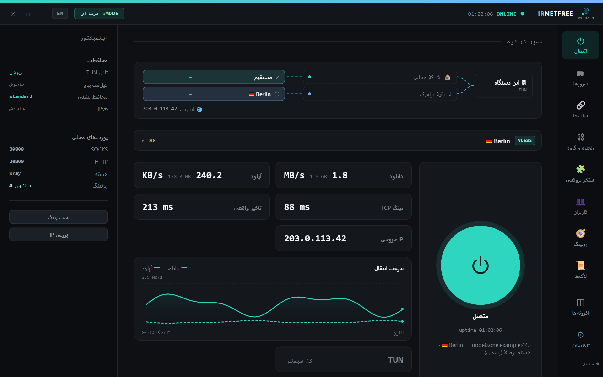
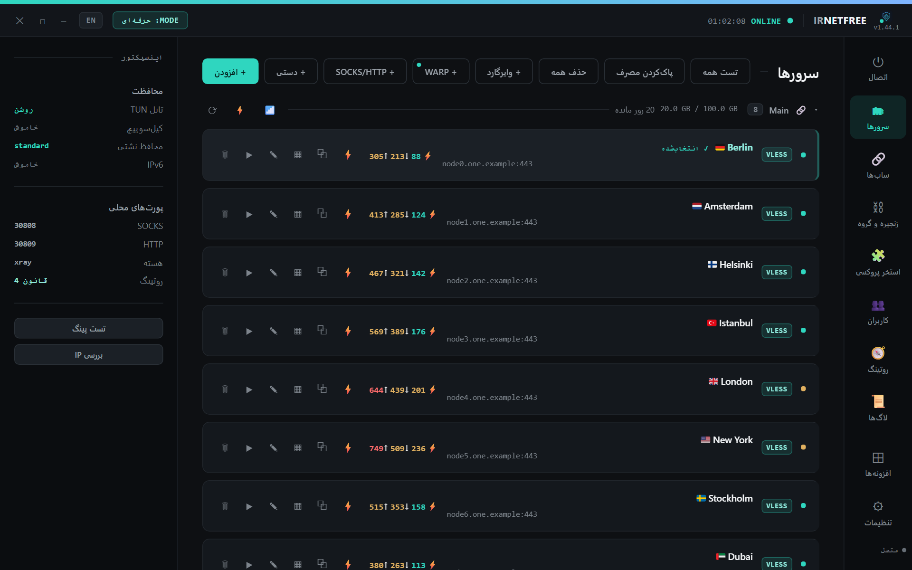
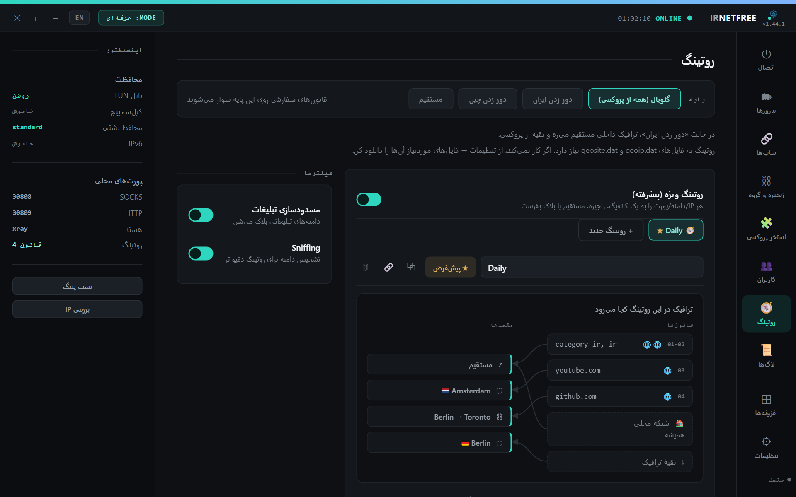
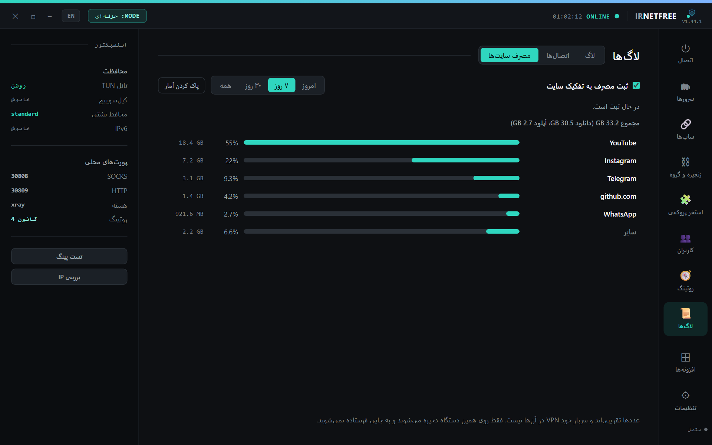
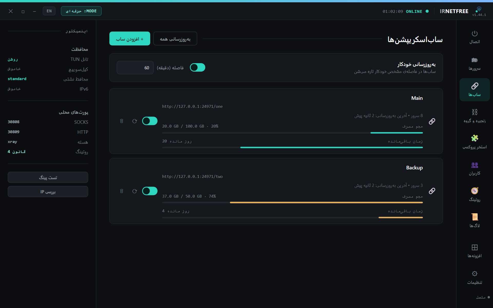
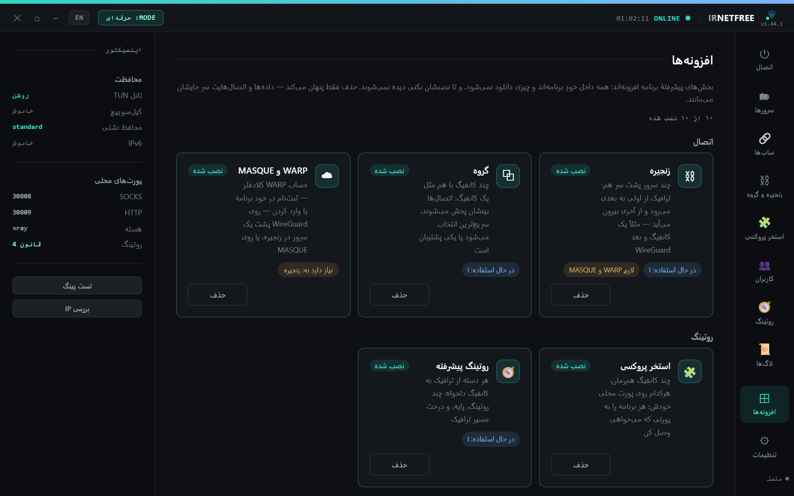
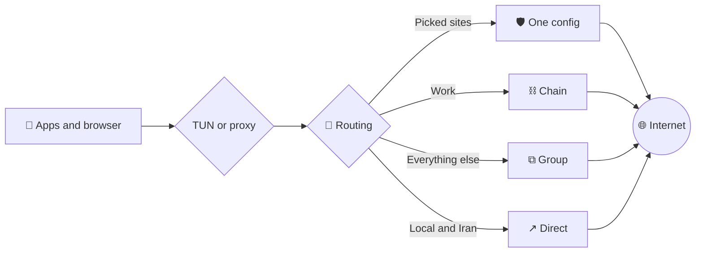

<div align="center">



<br>

[](https://github.com/sadrazkh/Irnetfree_xray-client/releases/latest)
[](https://github.com/sadrazkh/Irnetfree_xray-client/releases)
[](https://github.com/sadrazkh/Irnetfree_xray-client/actions/workflows/test.yml)
[](https://github.com/sadrazkh/Irnetfree_xray-client/stargazers)

[فارسی](README.md) · **English** · [📖 Full guide (Persian)](GUIDE.md)

### One app for every device: paste your subscription, press the button, you're connected.

[](#-download)
[](#-download)
[](#-download)
[](#-download)
[](#-download)

</div>

## 💎 Why IRNetFree?

<table>
  <tr>
    <td width="50%">🌍 <b>The same everywhere</b><br>Windows, macOS, Linux, Android, OpenWrt routers and even a server with no screen.</td>
    <td width="50%">📌 <b>Your config stays put</b><br>Even a panel that changes addresses and SNIs on every refresh won't scramble your selection, chains or routing.</td>
  </tr>
  <tr>
    <td>🧬 <b>Reads almost any config</b><br>From VLESS and REALITY to Hysteria2, TUIC, WireGuard and MASQUE, on three cores you can pick per config.</td>
    <td>🧭 <b>You decide where traffic goes</b><br>Send each site or app down the route you want, and watch the routes on a live diagram.</td>
  </tr>
  <tr>
    <td>👨‍👩‍👧 <b>For the whole house</b><br>Give each person their own login, data cap and config, and see what they used.</td>
    <td>🎚️ <b>Simple until you want more</b><br>Simple mode shows only what you need. Turn on the rest from Extensions when you want it.</td>
  </tr>
</table>

## 📸 A look at the app

The interface is available in Persian and English. These screenshots show the Persian one.

<table>
  <tr>
    <td width="50%"><br><b>⏻ Connect:</b> speed, ping, exit IP and the live traffic path</td>
    <td width="50%"><br><b>🗂 Servers:</b> grouped by subscription, with ping and real delay</td>
  </tr>
  <tr>
    <td><br><b>🧭 Routing:</b> a flow tree shows where each rule goes</td>
    <td><br><b>📊 Traffic by site:</b> roughly how much went to YouTube or Instagram</td>
  </tr>
  <tr>
    <td><br><b>🔗 Subscriptions:</b> data used and time left</td>
    <td><br><b>⊞ Extensions:</b> turn on advanced parts only if you need them</td>
  </tr>
</table>

<sub>Screenshots are from the app itself, with made-up servers and figures.</sub>

## 📥 Download

Get the latest version from the **[releases page](https://github.com/sadrazkh/Irnetfree_xray-client/releases/latest)**. `x.y.z` is the version number.

| System | File | Note |
|---|---|---|
| 🪟 **Windows** | `IRNetFree-Setup-x.y.z.exe` | Installer |
| | `IRNetFree-Portable-x.y.z.exe` | No install needed |
| 🍎 **macOS, Apple Silicon** | `IRNetFree-x.y.z-arm64.dmg` | [First run on a Mac](GUIDE.md#-اولین-اجرا-روی-مک-macos--first-run) |
| 🍏 **macOS, Intel** | `IRNetFree-x.y.z-x64.dmg` | Same guide |
| 🐧 **Linux** | `IRNetFree-x.y.z-amd64.deb` | Debian and Ubuntu |
| | `IRNetFree-x.y.z-x86_64.AppImage` | Most distributions |
| 🤖 **Android** | `IRNetFree-x.y.z.apk` | Android 8 or newer |
| 📡 **OpenWrt router** | `irnetfree_x.y.z_all.ipk` | [Router guide](docs/openwrt.md) |

<details>
<summary>📡 One-line install on a router</summary>

```sh
sh -c "$(wget -q -O - https://raw.githubusercontent.com/sadrazkh/Irnetfree_xray-client/main/openwrt/install.sh)"
```

Check [which routers fit](docs/openwrt.md#روتر-مناسب) first. CI runs this package on OpenWrt 23.05 and 24.10.

</details>

<details>
<summary>🖥️ One-line install on a Linux server with no screen</summary>

```bash
curl -fsSL https://raw.githubusercontent.com/sadrazkh/Irnetfree_xray-client/main/install.sh | bash
```

The same interface comes up on a web port, and you reach it over SSH. [Details](GUIDE.md#-نسخه-cli--سرور-بدون-gui-لینوکس-headless)

</details>

## ⚡ Start in a minute

1. Open the app. The first time, it asks to download the Xray core and the routing files. Press **Download**.
2. Copy a config or subscription link and press **Ctrl+V** anywhere in the app. On Android, use **Add config**.
3. Pick the config from the menu on the Connect page, or press **Auto** to find the fastest.
4. Press the big button. Green means connected ✅

> 💡 IRNetFree is a client and doesn't provide servers, so you need your own config or subscription. You can also get Cloudflare WARP from inside the app.

## ✨ Features

<details open>
<summary><b>🔌 Protocols and configs</b></summary>

- **Protocols:** VLESS (with REALITY, XTLS-Vision and XHTTP), VMess, Trojan, Shadowsocks, Hysteria2, WireGuard, SOCKS and HTTP
- **On sing-box only:** TUIC and AnyTLS
- **MASQUE and WARP:** WARP sign-up in the app, WARP+ with a key, and WARP behind a server in a chain
- **JSON configs:** full Xray and sing-box configs
- **Import:** a link, many links, base64, a subscription URL, a WireGuard `.conf` file, a manual form, Ctrl+V, and QR scanning and Share on Android
- **Opens with the app:** an [`irnetfree://` link](GUIDE.md#-دکمه‌ی-افزودن-به-irnetfree-برای-پنل) from a panel or site, after you confirm. `irnetfree://import/<percent-encoded link>` or `irnetfree://import?url=<…>&name=<…>`
- **Share:** a link and QR code for every config
- **Editor:** simple and pro modes, with Mux per server

</details>

<details>
<summary><b>🧬 Three cores</b></summary>

- **Official Xray**, **Xray-PattN** and **sing-box**, chosen per config
- Pick a core version and update it from inside the app
- The app writes each config in the form the running core version understands

</details>

<details>
<summary><b>🛡️ Getting past filtering</b></summary>

- Fragment and noise, plus `finalMask` and `cipherSuites` with ready-made presets
- **ECH** and the ECH outbound
- `dialMode` oob and uTLS fingerprints
- Certificate pinning on first use, in place of `allowInsecure`
- Swap a server's address for a clean IP, and keep it through subscription refreshes

</details>

<details>
<summary><b>🔗 Subscriptions</b></summary>

- Manual and automatic refresh, with bars for data used and time left
- Sort configs by ping, and a "next config" button when a connect fails
- Grouped and foldable by subscription, with ⚡ to find the fastest config in each
- Your selection, chains, routing and groups stay in place through a refresh, even when the panel rotates addresses
- Your own edits to a config are kept

</details>

<details>
<summary><b>🧭 Routing</b></summary>

- Simple modes: global, bypass Iran, bypass China, direct
- Custom rules by domain, IP and `geoip`/`geosite`; `example.com` is the name and what is under it, and so is `*.example.com`
- **Advanced routing:** several profiles, a shared base, a flow tree and share links
- Each route has its own colour on the home page
- **App routing:** a config per app on desktop, and app selection on Android

</details>

<details>
<summary><b>⛓️ Chains, groups and the pool</b></summary>

- **Chains:** traffic passes through several servers in a row
- **Groups:** several configs act as one, by load balancing, fastest or fallback, with members shown live
- **Proxy pool:** several configs at once, each on its own port
- **Corporate WireGuard:** keeps DNS and search domains, and turns `AllowedIPs` into a routing rule

</details>

<details>
<summary><b>👥 Network and users</b></summary>

- **LAN and hotspot sharing**, with a link and QR for each person
- **Users:** passwords, daily and monthly data caps, allowed hours, a config per user, top-up cards, usage reports and backups
- **Content filter and speed limits** per user
- **Two internets at once:** balance, failover or split XHTTP
- **Direct ports:** SOCKS or HTTP ports that stay outside the VPN

</details>

<details>
<summary><b>📊 Stats and diagnostics</b></summary>

- Live speed, a 60-second chart, usage per config and per route
- **Traffic by site:** how much went to YouTube, Instagram and the rest
- **Live connections** by app and destination
- TCP ping, real delay, IP and leak checks, and connection diagnostics

</details>

<details>
<summary><b>🔒 Reliability and protection</b></summary>

- **TUN or proxy:** tunnel the whole system, or only the apps that read a proxy
- **Leak guard and kill switch**
- Automatic recovery after a network change or wake from sleep
- On Android: a stall watchdog, a persistent log, and an engine restart if it gets stuck

</details>

<details>
<summary><b>📡 Router</b></summary>

- Every device at home goes through the VPN with nothing to install
- A web admin page and LuCI integration, a kill switch, and remote access
- A captive portal for users
- **Traffic by site per device**, designed to stay light on a router

</details>

### 🖥️ 📱 📡 What's available where

| Feature | Desktop | Android | Router |
|---|:--:|:--:|:--:|
| Chains, groups, pool, advanced routing | ✅ | ✅ | ✅ |
| WARP and MASQUE | ✅ | ✅ | ✅ |
| TUIC and AnyTLS | ✅ | ✅ | — |
| LAN sharing | ✅ | ✅ | Always |
| Users with passwords and data caps | ✅ | — | ✅ |
| Two internets at once | ✅ | — | ✅ |
| Traffic by site | ✅ | — | ✅ per device |
| A config per app | ✅ | App selection | — |
| Direct ports | ✅ | — | — |
| Captive portal and remote access | — | — | ✅ |

## 🧩 IRNetFree Plus

**[IRNetFree Plus](https://github.com/sadrazkh/Irnetfree_xray-client-plus)** is a separate tools app: a clean-IP scanner for Cloudflare, Fastly, CloudFront and Gcore ranges, plus Server and Configs sections.

## 🗺️ Where your traffic goes



## 📖 Documentation

- **[GUIDE.md](GUIDE.md):** the full manual, in Persian
- **[docs/openwrt.md](docs/openwrt.md):** the router guide, in Persian
- **[docs/releases](docs/releases):** what changed in each version, in English

## ❓ FAQ

<details>
<summary><b>Does the app provide servers or free internet?</b></summary>

No. IRNetFree is a client and needs your own config or subscription. The only exception is Cloudflare WARP, which you can get from inside the app.

</details>

<details>
<summary><b>Why does it download something the first time?</b></summary>

The cores and routing files update separately from the app, so they're downloaded with your permission the first time.

</details>

<details>
<summary><b>Why does Windows ask for admin rights?</b></summary>

TUN mode creates a virtual network adapter, which needs admin rights. Proxy mode works without them.

</details>

<details>
<summary><b>Where do my configs and keys go?</b></summary>

They stay on your device and aren't sent anywhere. The app only fetches the subscription links you added, and talks to GitHub for updates.

</details>

<details>
<summary><b>Android got stuck. What should I do?</b></summary>

Open **Logs → Share** and [send a report](https://github.com/sadrazkh/Irnetfree_xray-client/issues).

</details>

## 🛠️ Build from source

```bash
git clone https://github.com/sadrazkh/Irnetfree_xray-client.git
cd Irnetfree_xray-client
npm install
npm run get-xray
npm start
```

`npm test` needs Node.js 21 or newer.

## 🙏 Built with

[Xray-core](https://github.com/XTLS/Xray-core) · [Xray-PattN](https://github.com/patterniha/Xray-core) · [sing-box](https://github.com/SagerNet/sing-box) · [AndroidLibXrayLite](https://github.com/2dust/AndroidLibXrayLite) · [hev-socks5-tunnel](https://github.com/heiher/hev-socks5-tunnel) · [tun2socks](https://github.com/xjasonlyu/tun2socks) · [Wintun](https://www.wintun.net/) · [Electron](https://www.electronjs.org/)

<div align="center">

<br>

**If it helped you, leave a ⭐ so others can find it.**

[🐞 Report a problem](https://github.com/sadrazkh/Irnetfree_xray-client/issues) · [🧾 Releases](https://github.com/sadrazkh/Irnetfree_xray-client/releases)

</div>
