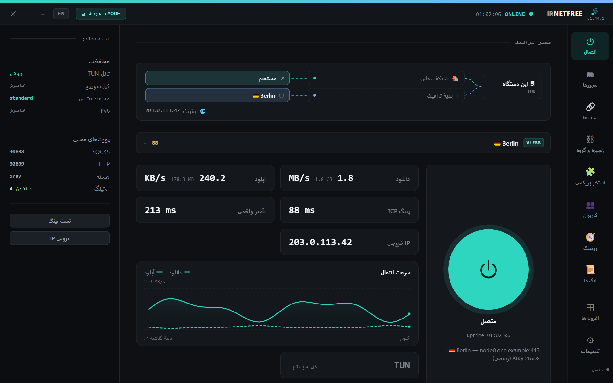
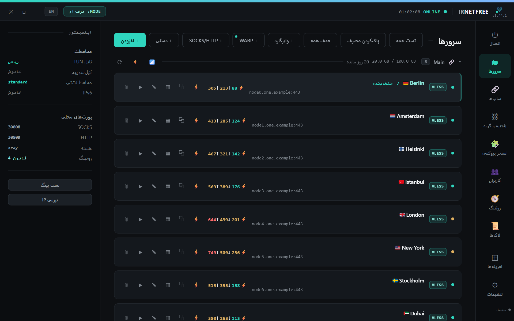
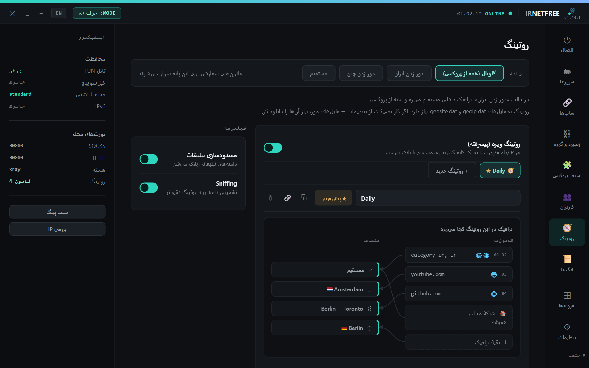
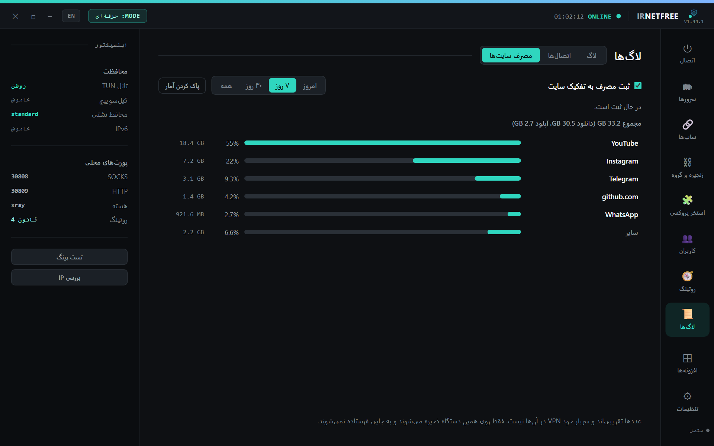
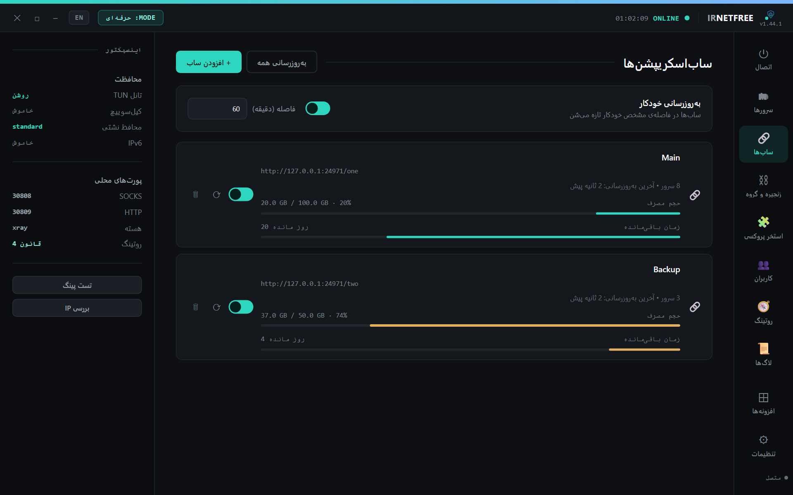
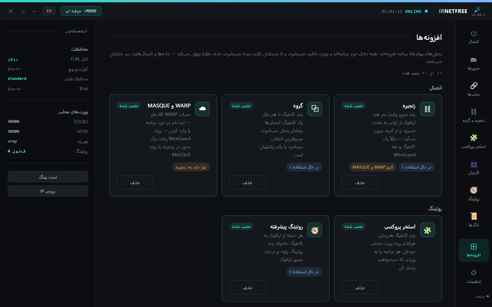
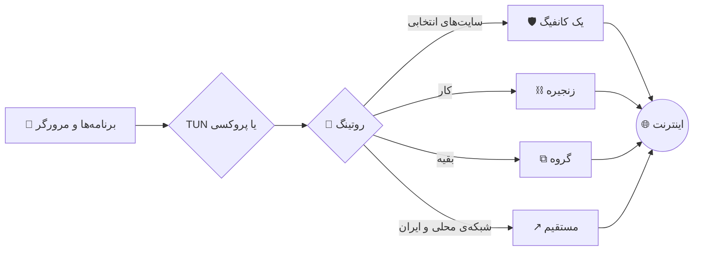

<div align="center">



<br>

[](https://github.com/sadrazkh/Irnetfree_xray-client/releases/latest)
[](https://github.com/sadrazkh/Irnetfree_xray-client/releases)
[](https://github.com/sadrazkh/Irnetfree_xray-client/actions/workflows/test.yml)
[](https://github.com/sadrazkh/Irnetfree_xray-client/stargazers)

**فارسی** · [English](README.en.md) · [📖 راهنمای کامل](GUIDE.md)

### یک برنامه برای همه‌ی دستگاه‌ها: لینک ساب را بچسبان، دکمه را بزن، وصل شو.

[](#-دانلود)
[](#-دانلود)
[](#-دانلود)
[](#-دانلود)
[](#-دانلود)

</div>

<div dir="rtl">

## 💎 چرا IRNetFree؟

<table>
  <tr>
    <td width="50%">🌍 <b>همه‌جا یکی</b><br>ویندوز، مک، لینوکس، اندروید، روتر OpenWrt و حتی سرور بدون صفحه‌نمایش، با یک تجربه.</td>
    <td width="50%">📌 <b>کانفیگت سر جایش می‌ماند</b><br>حتی پنلی که با هر به‌روزرسانی آدرس و SNI را عوض می‌کند، انتخاب، چین و روتینگت را به هم نمی‌ریزد.</td>
  </tr>
  <tr>
    <td>🧬 <b>هر کانفیگی را می‌خواند</b><br>از VLESS و REALITY تا Hysteria2، TUIC، WireGuard و MASQUE، با سه هسته که برای هر کانفیگ جدا انتخاب می‌شوند.</td>
    <td>🧭 <b>ترافیک دست خودت است</b><br>هر سایت یا برنامه از همان مسیری می‌رود که می‌خواهی، و مسیر را روی نمودار می‌بینی.</td>
  </tr>
  <tr>
    <td>👨‍👩‍👧 <b>برای کل خانه</b><br>به هر نفر نام کاربری، سقف حجم و کانفیگ جدا بده و ببین چقدر مصرف کرده.</td>
    <td>🎚️ <b>ساده، مگر بخواهی حرفه‌ای باشد</b><br>حالت ساده فقط چیزهای لازم را نشان می‌دهد. بقیه را هر وقت خواستی از «افزونه‌ها» روشن کن.</td>
  </tr>
</table>

## 📸 نگاهی به برنامه

<table>
  <tr>
    <td width="50%"><br><b>⏻ اتصال:</b> سرعت، پینگ، IP خروجی و مسیر زنده‌ی ترافیک</td>
    <td width="50%"><br><b>🗂 سرورها:</b> به تفکیک ساب، با پینگ و تأخیر واقعی هر کانفیگ</td>
  </tr>
  <tr>
    <td><br><b>🧭 روتینگ:</b> درخت مسیر نشان می‌دهد هر قانون به کجا می‌رود</td>
    <td><br><b>📊 مصرف سایت‌ها:</b> حدوداً چقدر رفت به YouTube و Instagram</td>
  </tr>
  <tr>
    <td><br><b>🔗 ساب‌ها:</b> حجم مصرفی و زمان باقی‌مانده</td>
    <td><br><b>⊞ افزونه‌ها:</b> هر چیز پیشرفته را فقط اگر لازم داری روشن کن</td>
  </tr>
</table>

<sub>عکس‌ها از خود برنامه‌اند، با سرورها و عددهای ساختگی.</sub>

## 📥 دانلود

آخرین نسخه را از **[صفحه‌ی انتشارها](https://github.com/sadrazkh/Irnetfree_xray-client/releases/latest)** بگیر. `x.y.z` شماره‌ی نسخه است.

| سیستم | فایل | نکته |
|---|---|---|
| 🪟 **ویندوز** | `IRNetFree-Setup-x.y.z.exe` | نصبی |
| | `IRNetFree-Portable-x.y.z.exe` | بدون نصب |
| 🍎 **مک، Apple Silicon** | `IRNetFree-x.y.z-arm64.dmg` | [اولین اجرا روی مک](GUIDE.md#-اولین-اجرا-روی-مک-macos--first-run) |
| 🍏 **مک، Intel** | `IRNetFree-x.y.z-x64.dmg` | همان راهنما |
| 🐧 **لینوکس** | `IRNetFree-x.y.z-amd64.deb` | دبیان و اوبونتو |
| | `IRNetFree-x.y.z-x86_64.AppImage` | بیشتر توزیع‌ها |
| 🤖 **اندروید** | `IRNetFree-x.y.z.apk` | اندروید ۸ به بالا |
| 📡 **روتر OpenWrt** | `irnetfree_x.y.z_all.ipk` | [راهنمای روتر](docs/openwrt.md) |

<details>
<summary>📡 نصب یک‌خطی روی روتر</summary>

<div dir="ltr">

```sh
sh -c "$(wget -q -O - https://raw.githubusercontent.com/sadrazkh/Irnetfree_xray-client/main/openwrt/install.sh)"
```

</div>

اول [روتر مناسب](docs/openwrt.md#روتر-مناسب) را ببین. این نسخه در CI روی OpenWrt 23.05 و 24.10 اجرا و آزموده می‌شود.

</details>

<details>
<summary>🖥️ نصب یک‌خطی روی سرور لینوکس بدون صفحه‌نمایش</summary>

<div dir="ltr">

```bash
curl -fsSL https://raw.githubusercontent.com/sadrazkh/Irnetfree_xray-client/main/install.sh | bash
```

</div>

همان رابط کاربری روی یک پورت وب بالا می‌آید و با SSH به آن وصل می‌شوی. [جزئیات](GUIDE.md#-نسخه-cli--سرور-بدون-gui-لینوکس-headless)

</details>

## ⚡ شروع در یک دقیقه

1. برنامه را باز کن. بار اول اجازه می‌خواهد هسته‌ی Xray و فایل‌های روتینگ را دانلود کند؛ **«دانلود کن»** را بزن.
2. لینک کانفیگ یا ساب را کپی کن و هرجای برنامه **Ctrl+V** بزن. در اندروید از دکمه‌ی **«افزودن کانفیگ»** استفاده کن.
3. از منوی بالای صفحه‌ی اتصال، کانفیگ را انتخاب کن، یا **«خودکار»** را بزن تا سریع‌ترین پیدا شود.
4. دکمه‌ی بزرگ را بزن. سبز شد یعنی وصلی ✅

> 💡 این برنامه فقط کلاینت است و خودش سرور نمی‌دهد. به کانفیگ یا ساب خودت نیاز داری. WARP کلادفلر را هم می‌توانی از داخل برنامه بگیری.

## ✨ امکانات

<details open>
<summary><b>🔌 پروتکل‌ها و کانفیگ</b></summary>

- **پروتکل‌ها:** VLESS (با REALITY، XTLS-Vision و XHTTP)، VMess، Trojan، Shadowsocks، Hysteria2، WireGuard، SOCKS و HTTP
- **فقط با sing-box:** TUIC و AnyTLS
- **MASQUE و WARP:** ثبت‌نام WARP در خود برنامه، WARP+ با کلید، و WARP پشت یک سرور در چین
- **کانفیگ JSON:** کانفیگ کامل Xray و sing-box
- **وارد کردن:** لینک، چند لینک با هم، base64، لینک ساب، فایل `.conf` وایرگارد، فرم دستی، Ctrl+V، و اسکن QR در اندروید
- **اشتراک‌گذاری:** لینک و QR برای هر کانفیگ
- **ویرایشگر:** حالت ساده و حرفه‌ای، با تنظیم Mux برای هر سرور

</details>

<details>
<summary><b>🧬 سه هسته</b></summary>

- **Xray رسمی**، **Xray-PattN** و **sing-box**؛ برای هر کانفیگ جدا قابل انتخاب
- انتخاب نسخه‌ی هسته و به‌روزرسانی از داخل برنامه
- برنامه با همان نسخه‌ی هسته‌ای که اجرا می‌کند هماهنگ کانفیگ می‌نویسد

</details>

<details>
<summary><b>🛡️ عبور از فیلترینگ</b></summary>

- Fragment و Noise، و `finalMask` و `cipherSuites` با پریست آماده
- **ECH** و خروجی ECH
- `dialMode` نوع oob و اثرانگشت‌های uTLS
- پین‌کردن گواهی در اولین استفاده، به‌جای `allowInsecure`
- جایگزینی آدرس سرور با IP تمیز، که با به‌روزرسانی ساب از بین نمی‌رود

</details>

<details>
<summary><b>🔗 ساب‌اسکریپشن</b></summary>

- به‌روزرسانی دستی و خودکار، با نوار حجم و زمان باقی‌مانده
- گروه‌بندی و جمع‌کردن هر ساب، و ⚡ پیدا کردن سریع‌ترین کانفیگ در هر ساب
- کانفیگ انتخابی، چین، روتینگ و گروه با به‌روزرسانی ساب سر جایشان می‌مانند، حتی اگر پنل آدرس‌ها را بچرخاند
- ویرایش‌های خودت روی کانفیگ حفظ می‌شوند

</details>

<details>
<summary><b>🧭 روتینگ</b></summary>

- حالت ساده: گلوبال، دور زدن ایران، دور زدن چین، مستقیم
- قوانین سفارشی با دامنه، IP و `geoip`/`geosite`
- **روتینگ پیشرفته:** چند پروفایل، پایه‌ی مشترک، درخت مسیر و لینک اشتراک‌گذاری
- مسیر هر قانون با رنگ خودش روی صفحه‌ی اصلی
- **روتینگ برنامه‌ها:** برای هر برنامه کانفیگ جدا در دسکتاپ، و انتخاب برنامه‌ها در اندروید

</details>

<details>
<summary><b>⛓️ زنجیره، گروه و استخر</b></summary>

- **زنجیره:** ترافیک از چند سرور پشت‌سرهم رد می‌شود
- **گروه:** چند کانفیگ مثل یکی کار می‌کنند؛ با پخش بار، سریع‌ترین یا پشتیبان، و نمایش زنده‌ی عضوها
- **استخر پروکسی:** چند کانفیگ هم‌زمان، هرکدام روی پورت خودش
- **وایرگارد شرکتی:** DNS و دامنه‌ها حفظ می‌شوند و `AllowedIPs` به قانون روتینگ تبدیل می‌شود

</details>

<details>
<summary><b>👥 شبکه و کاربران</b></summary>

- **اشتراک در شبکه‌ی محلی و هات‌اسپات**، با لینک و QR برای هر نفر
- **کاربران:** رمز، سقف حجم روزانه و ماهانه، ساعت مجاز، کانفیگ جدا، کارت شارژ، گزارش مصرف و پشتیبان
- **فیلتر محتوا و محدودیت سرعت** برای هر کاربر
- **دو اینترنت با هم:** پخش بار، پشتیبان یا تقسیم XHTTP
- **پورت مستقیم:** پورت SOCKS یا HTTP که از VPN رد نمی‌شود

</details>

<details>
<summary><b>📊 آمار و عیب‌یابی</b></summary>

- سرعت زنده، نمودار ۶۰ ثانیه، مصرف هر کانفیگ و هر مسیر
- **مصرف به تفکیک سایت:** چقدر رفت به YouTube، Instagram و بقیه
- **اتصال‌های زنده** به تفکیک برنامه و مقصد
- پینگ TCP، تأخیر واقعی، بررسی IP و نشتی، و عیب‌یابی اتصال

</details>

<details>
<summary><b>🔒 پایداری و حفاظت</b></summary>

- **TUN یا پروکسی:** تونل کل سیستم، یا فقط برنامه‌هایی که پروکسی می‌خوانند
- **گارد نشتی و کیل‌سوییچ**
- برگشت خودکار بعد از تغییر شبکه یا بیدار شدن دستگاه
- در اندروید: نگهبان قطعی، لاگ ماندگار و راه‌اندازی دوباره‌ی موتور اگر گیر کند

</details>

<details>
<summary><b>📡 روتر</b></summary>

- همه‌ی دستگاه‌های خانه بدون نصب برنامه از VPN رد می‌شوند
- صفحه‌ی مدیریت وب و یکپارچگی با LuCI، کیل‌سوییچ، و دسترسی از راه دور
- پورتال ورود برای کاربران
- **مصرف سایت‌ها به تفکیک هر دستگاه**، با طراحی کم‌مصرف برای روتر

</details>

### 🖥️ 📱 📡 چه چیزی کجا هست؟

| قابلیت | دسکتاپ | اندروید | روتر |
|---|:--:|:--:|:--:|
| چین، گروه، استخر، روتینگ پیشرفته | ✅ | ✅ | ✅ |
| WARP و MASQUE | ✅ | ✅ | ✅ |
| TUIC و AnyTLS | ✅ | ✅ | — |
| اشتراک در شبکه‌ی محلی | ✅ | ✅ | همیشه |
| کاربران با رمز و سقف حجم | ✅ | — | ✅ |
| دو اینترنت با هم | ✅ | — | ✅ |
| مصرف به تفکیک سایت | ✅ | — | ✅ به تفکیک دستگاه |
| کانفیگ جدا برای هر برنامه | ✅ | انتخاب برنامه‌ها | — |
| پورت مستقیم | ✅ | — | — |
| پورتال ورود و دسترسی از راه دور | — | — | ✅ |

## 🧩 جعبه‌ابزار: IRNetFree Plus

برنامه‌ی جدای **[IRNetFree Plus](https://github.com/sadrazkh/Irnetfree_xray-client-plus)** برای ابزارهاست: اسکن IP تمیز روی رنج‌های Cloudflare، Fastly، CloudFront و Gcore، به‌علاوه‌ی بخش‌های سرور و کانفیگ.

## 🗺️ ترافیکت از کجا می‌رود؟

<div dir="ltr">



</div>

## 📖 راهنمای کامل

همه‌ی جزئیات در **[GUIDE.md](GUIDE.md)** است:

| شروع | اتصال | شبکه | بیشتر |
|---|---|---|---|
| [نصب و اجرا](GUIDE.md#-نصب-و-اجرا-setup) | [پروکسی یا TUN](GUIDE.md#-حالت-اتصال-پروکسی-یا-tun-connection-mode) | [روتینگ](GUIDE.md#-روتینگ-routing) | [مرجع تنظیمات](GUIDE.md#️-مرجع-تنظیمات-settings-reference) |
| [افزودن کانفیگ](GUIDE.md#-افزودن-کانفیگ‌ها-adding-configs) | [هسته‌ها](GUIDE.md#-دو-هسته‌ی-xray-cores) | [زنجیره](GUIDE.md#️-زنجیره-پروکسی-proxy-chains) | [عیب‌یابی](GUIDE.md#️-عیب‌یابی-troubleshooting) |
| [ساب‌اسکریپشن](GUIDE.md#-ساب‌اسکریپشن-subscriptions) | [پین گواهی](GUIDE.md#-پین‌کردن-گواهی-certificate-pinning) | [وایرگارد شرکتی](GUIDE.md#-وایرگارد-شرکتی-corporate-wireguard) | [معماری](GUIDE.md#️-معماری-architecture) |
| [اندروید](GUIDE.md#-نسخه-اندروید-android) | [کیل‌سوییچ](GUIDE.md#-کیل‌سوییچ-kill-switch) | [DNS](GUIDE.md#-dns) | [امنیت](GUIDE.md#-امنیت-security) |
| [روتر](docs/openwrt.md) | [آمار و تست](GUIDE.md#-آمار-و-تست-stats--testing) | [اشتراک LAN](GUIDE.md#-اشتراک-در-شبکه-محلی-lan) | [تغییرات هر نسخه](docs/releases) |

## ❓ پرسش‌های پرتکرار

<details>
<summary><b>خود برنامه سرور یا اینترنت رایگان می‌دهد؟</b></summary>

نه. IRNetFree کلاینت است و به کانفیگ یا ساب خودت نیاز دارد. فقط WARP کلادفلر را می‌توانی از داخل برنامه بگیری.

</details>

<details>
<summary><b>چرا بار اول چیزی دانلود می‌کند؟</b></summary>

هسته‌ها و فایل‌های روتینگ جدا از برنامه به‌روز می‌شوند، پس بار اول با اجازه‌ی تو دانلود می‌شوند.

</details>

<details>
<summary><b>چرا ویندوز دسترسی ادمین می‌خواهد؟</b></summary>

حالت TUN یک کارت شبکه‌ی مجازی می‌سازد و این کار ادمین می‌خواهد. حالت پروکسی بدون ادمین هم کار می‌کند. [جزئیات](GUIDE.md#-اجرای-با-دسترسی-ادمین-run-as-admin)

</details>

<details>
<summary><b>مک برنامه را باز نمی‌کند.</b></summary>

راه‌حلش در [اولین اجرا روی مک](GUIDE.md#-اولین-اجرا-روی-مک-macos--first-run) آمده است.

</details>

<details>
<summary><b>کانفیگ‌ها و کلیدهایم کجا می‌روند؟</b></summary>

روی همان دستگاه می‌مانند و به جایی فرستاده نمی‌شوند. برنامه فقط لینک ساب‌هایی را که خودت اضافه کرده‌ای می‌گیرد، و برای به‌روزرسانی با GitHub حرف می‌زند. [بخش امنیت](GUIDE.md#-امنیت-security)

</details>

<details>
<summary><b>اندروید گیر کرد. چه کار کنم؟</b></summary>

از **لاگ‌ها ← Share** لاگ را بگیر و [یک گزارش بفرست](https://github.com/sadrazkh/Irnetfree_xray-client/issues).

</details>

## 🛠️ ساخت از سورس

<div dir="ltr">

```bash
git clone https://github.com/sadrazkh/Irnetfree_xray-client.git
cd Irnetfree_xray-client
npm install
npm run get-xray
npm start
```

</div>

برای `npm test` به Node.js نسخه‌ی ۲۱ یا بالاتر نیاز داری. [ساخت نسخه‌ی نصبی](GUIDE.md#️-ساخت-نسخه-نصبی-build) · [نسخه‌ی اندروید](GUIDE.md#-نسخه-اندروید-android)

## 🙏 ساخته شده با

[Xray-core](https://github.com/XTLS/Xray-core) · [Xray-PattN](https://github.com/patterniha/Xray-core) · [sing-box](https://github.com/SagerNet/sing-box) · [AndroidLibXrayLite](https://github.com/2dust/AndroidLibXrayLite) · [hev-socks5-tunnel](https://github.com/heiher/hev-socks5-tunnel) · [tun2socks](https://github.com/xjasonlyu/tun2socks) · [Wintun](https://www.wintun.net/) · [Electron](https://www.electronjs.org/)

</div>

<div align="center">

<br>

**اگر به کارت آمد، یک ⭐ بده تا بقیه هم پیدایش کنند.**

[🐞 گزارش مشکل](https://github.com/sadrazkh/Irnetfree_xray-client/issues) · [🧾 انتشارها](https://github.com/sadrazkh/Irnetfree_xray-client/releases)

</div>
