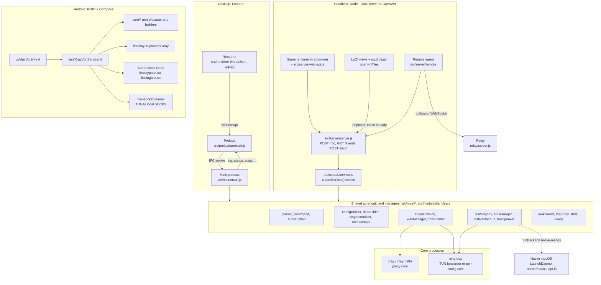
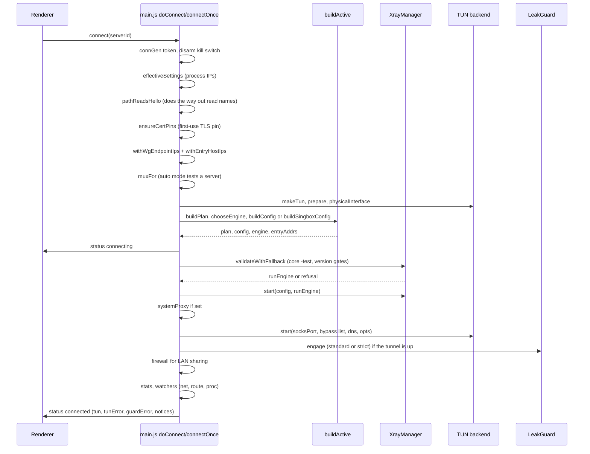
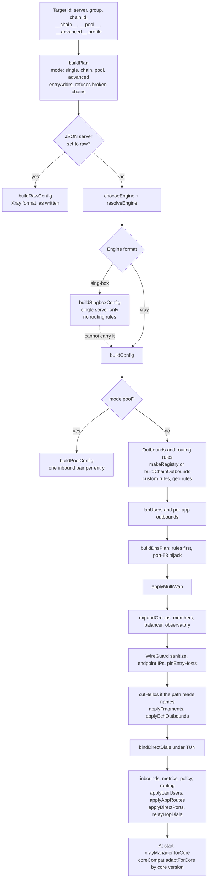
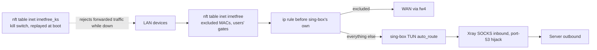
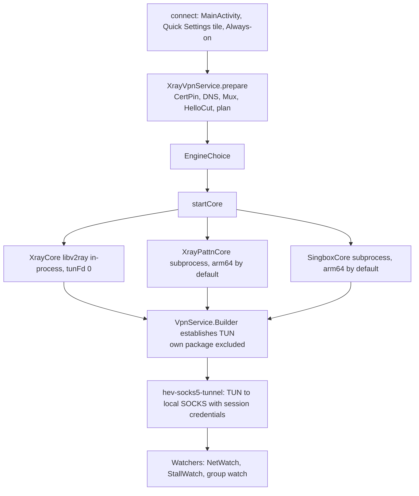
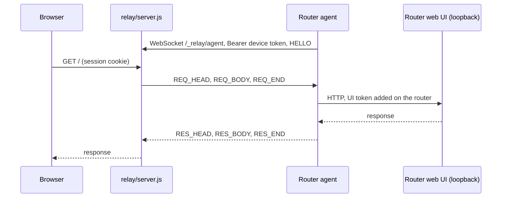

Last verified: 2026-11-08
Scope: `src/main`, `src/server`, `src/preload`, `src/renderer` (structure), `src/modules/lanUsers`, `openwrt/`, `android/app/src/main`, `native/macos`, `relay/`, at commit 3e5b74d. Read only.

# Architecture

Labels: **[V]** Verified (evidence named), **[A]** Assumption, **[R]** Recommendation.

## 1. Component map

Evidence [V]: requires at the top of `main.js` and `service.js`; `server.js` `handle`; `openwrt/files/rpcd/luci.irnetfree` (POST to `/luci/<method>`); `XrayVpnService.startCore`; `native/macos/Bridge.swift` (`SMAppService.daemon`); `src/server/remote/agent.js`.

| Boundary | Mechanism | Evidence [V] |
|---|---|---|
| Renderer to main | `contextBridge` `window.api`, `ipcRenderer.invoke`; `contextIsolation: true`, `nodeIntegration: false`, `sandbox: false` | `preload.js`; `createWindow` in `main.js` |
| Browser to headless | `POST /rpc {channel,arg}`, `GET /events` SSE, same channel names | `web-api.js`; `server.js` `handle`; `service.js` `handlers` |
| LuCI to service | rpcd plugin posts to `/luci/<method>` from loopback, token in body | `src/server/luciApi.js`; `isLoopbackPeer` |
| Router to relay | Outbound WebSocket, binary frames, device token | `src/server/remote/agent.js`, `frames.js` |
| App to core | Spawned process, JSON config file, `xray run -test` first; live counters over HTTP `/debug/vars` | `xrayManager.js` `validateWithFallback`, `start`; `stats.js` |

## 2. Connect path (desktop)

`service.js` follows the same steps in its own `connectOnce`, plus router gates. Android's path is in section 5.

Rules that shape this path [V: all in `connectOnce`, `main.js`]:

- Every `await` is followed by `stale()`: a newer connect or a disconnect overtakes the call through `connGen`, and `giveWay` undoes what this call started.
- TUN failure is **not** a connect failure. The call stays connected proxy-only and returns `tunError`. See KI-004 for the comment that says otherwise.
- A failure on the core's `-test` becomes a named error (ECH, MASQUE, PattN OOB, plaintext).
- `startedTuns` tracks every backend a connect started, so a replaced `tun` can still be torn down.

## 3. How a config is built

Evidence [V]: `buildPlan`, `buildActive` in `main.js`; `buildConfig`, `buildPoolConfig`, `buildRawConfig`, `expandGroups`, `relayHopDials` in `configBuilder.js`; `buildSingboxConfig` in `singboxBuilder.js`; `forCore` in `xrayManager.js`.

Order is load-bearing: the DNS rules go ahead of the private-IP bypass, group rules ahead of the DNS rules, and `relayHopDials` runs last (comments inside `buildConfig`) [V].

## 4. TUN backends

| Backend | File | Chosen when | Traffic path | Evidence [V] |
|---|---|---|---|---|
| sing-box | `tunSingbox.js` | Default on desktop when installed | sing-box `tun` inbound with `auto_route`, forwarding to the core's SOCKS inbound | `makeTun`; file header |
| tun2socks | `tunManager.js` | `tunBackend` set to it, or sing-box missing | wintun or utun, manual routes | `makeTun` |
| Native macOS | `nativeMacTun.js` + `native/macos` | darwin and `tunBackend: 'native-macos'` only | Root LaunchDaemon runs sing-box | `makeTun`; `TunnelService.swift` |
| OpenWrt gateway | `tunOpenwrt.js` | Always on a router | Composes sing-box, adds an nft table and `ip rule` entries | `service.js` `makeTun`; file header |

Under any backend Xray stays the proxy core and the TUN only feeds its SOCKS inbound, except a server running on the sing-box engine, where sing-box's own config serves SOCKS instead [V: `tunSingbox.js` header; `buildActive`].

Evidence [V]: header and `setLanUsers` in `tunOpenwrt.js`; header of `killSwitchOpenwrt.js`; `openwrt/files/irnetfree-ks.init`. On a router `managesDns` is true, so the leak guard stays out and dnsmasq is untouched.

## 5. Android session

Evidence [V]: `XrayVpnService.kt` class comment, `prepare`, `startCore`; `TunnelSetup.kt`; `core/LocalAuth.kt`; `android/scripts/fetch-libs.sh`. Commands run on one worker thread with a generation number; native stops are bounded (`EngineReset.bounded`).

Cores ship inside the APK, because Android 10 and newer will not execute files an app downloaded [V: comment in `android/scripts/fetch-libs.sh`].

## 6. Failure and recovery

| Concern | Desktop | Router | Android | Evidence [V] |
|---|---|---|---|---|
| Network moved | `netWatcher.js`, `recoverFromNetworkChange` | `wanWatch.js`, `judgeWanChange`: a probe decides before any rebuild | `NetWatch` | those files |
| Core died | `onConnectionDrop`, `runRecovery`, `DropBudget` | `recoverFromDrop`, `backoffAfter`, tunnel watch | restart once, then fail (`onCoreExit`) | `main.js`, `service.js`, `XrayVpnService.kt` |
| Kill switch | Windows firewall rule only (`armKillSwitch`) | nft table `inet irnetfree_ks`, armed from boot | system Always-on / lockdown | `main.js`; `killSwitchOpenwrt.js`; manifest `SUPPORTS_ALWAYS_ON` |
| DNS held across rebuild | `leakGuard.holdForReconnect`, receipt tokens, `tun-state.json` crash record | not used, gateway owns DNS | not applicable | `leakGuard.js` header |
| System proxy recovery | `proxy-journal.json` | same file logic on headless | not applicable | `sysproxy.js` `useProxyJournal` |

## 7. Remote access

Evidence [V]: `relay/server.js`, `src/server/remote/agent.js`, `frames.js`. The relay sees plaintext by design (`relay/server.js` header). The Cloudflare Tunnel alternative is `src/server/remote/cloudflared.js`. Details: [docs/remote.md](remote.md).

## 8. Size and shape

Largest files [V: `wc -l`]: `src/renderer/app.js` 11,112; `android/.../ui/MainActivity.kt` 5,185; `src/server/service.js` 4,675; `src/main/main.js` 4,607; `src/renderer/i18n.js` 3,432; `src/renderer/lanUsers.js` 3,349. Pure modules (`parser`, `configBuilder`, `groups`, `routingProfiles`, ...) take no store or Electron, which is what makes the test suite possible [V: headers of those files].
